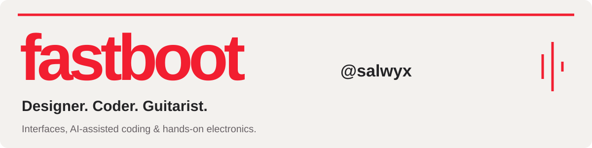
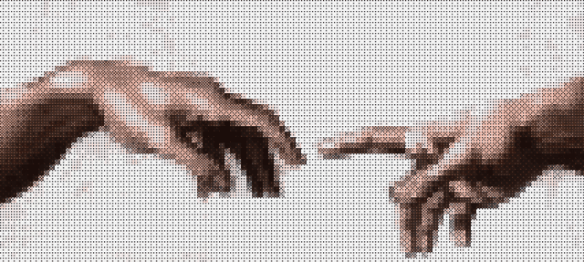

**[Explore my portfolio ↗](https://salwyx.github.io/)** · [Let’s build at a hackathon ↗](https://t.me/biden911)

### Code on screen. Hands on hardware.

I design interfaces and build with **React, TypeScript and Java 21**. I explore **AI-assisted coding** with Claude, ChatGPT and Google Antigravity. Outside the editor, I play guitar and solder electronics.

My [portfolio](https://salwyx.github.io/) is a sample of my design work — typography, layout, ASCII art and motion.

### Stack & tools

**Java 21** · IntelliJ IDEA · VS Code · **I use CachyOS, btw.**

### Off the keyboard

**A little Red Special energy.**

Brian May is an inspiration. I play guitar, work with a soldering iron and share my practice, experiments and progress on TikTok.

[Follow my progress — @fastboot69 ↗](https://www.tiktok.com/@fastboot69)

[Visit my Brian May corner ↗](https://salwyx.github.io/#brian-corner)

 

**[OPEN THE FULL EXPERIENCE → SALWYX.GITHUB.IO](https://salwyx.github.io/)**

### Find me

[**TikTok ↗**](https://www.tiktok.com/@fastboot69) &nbsp; / &nbsp; [**Telegram ↗**](https://t.me/biden911) &nbsp; / &nbsp; [**YouTube ↗**](https://www.youtube.com/@f4stb00t) &nbsp; / &nbsp; **Discord: @f4stb00t**

[**alikutubaev2005@gmail.com ↗**](mailto:alikutubaev2005@gmail.com)

### Activity

[Interactive portfolio](https://salwyx.github.io/) · [Photo credits](PHOTO-CREDITS.md)
